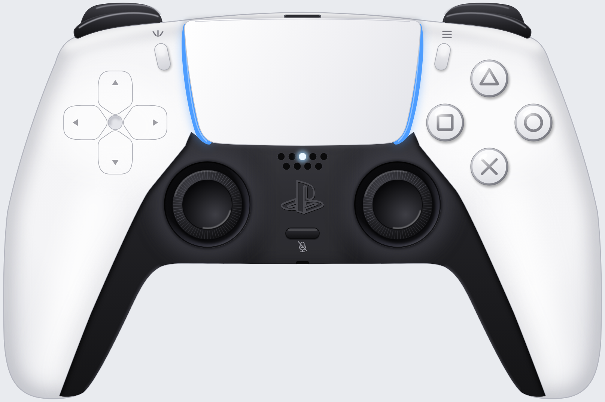

# PS5 DualSense 컨트롤러 SVG

소니 PlayStation 5 DualSense 무선 컨트롤러(흰색 표준 모델, CFI-ZCT1W)를 정면에서 본 모습을 그린 SVG 일러스트입니다.
실물 치수(160 × 106 mm)에 맞춘 좌표계 위에 손으로 베지어 곡선을 그렸고, 배경은 투명합니다.



## 파일

| 경로 | 설명 |
|---|---|
| `dualsense.svg` | 완성본. `viewBox="-8 -8 1616 1076"`, 10단위 = 1 mm. 컨트롤러 자체는 x 0–1600, y 0–1060(트리거 끝부터 그립 끝까지)을 차지합니다. 외부 참조와 CSS가 없어 어디에나 그대로 넣을 수 있습니다. |
| `preview/dualsense.png` | 투명 배경 렌더 (1616 × 1076) |
| `preview/dualsense-on-grey.png` | 밝은 회색 배경 렌더 |
| `tools/build_dualsense.py` | SVG를 생성하는 스크립트. 색상표와 모든 좌표가 여기 있습니다. |
| `tools/svgkit.py` | 경로 작성, 좌우 대칭 복제, 그라디언트 도우미 |
| `tools/render.js` | Playwright + Chromium으로 SVG를 PNG로 렌더 |

## 구조

모든 `id`에는 `ds-` 접두사가 붙어 있어서 다른 SVG와 한 문서에 인라인으로 넣어도 충돌하지 않습니다.
부품마다 `<g>`로 묶여 있어 CSS나 스크립트로 개별 부품을 강조하거나 숨길 수 있습니다.

```
ds-triggers        ds-trigger-l2, ds-trigger-r2
ds-shell           ds-shell-body, ds-shell-shading, ds-usb-c
ds-bumpers         ds-bumper-l1, ds-bumper-r1
ds-inner-section   ds-inner-section-body, ds-inner-shading   (스틱 주변의 검은 부분과 그립 안쪽 띠)
ds-touchpad        ds-touchpad-surface, ds-lightbar-l, ds-lightbar-r
ds-player-indicator, ds-speaker
ds-ps-button, ds-mute-button (ds-mute-icon), ds-headset-jack
ds-stick-l, ds-stick-r
ds-dpad            ds-dpad-up, ds-dpad-right, ds-dpad-down, ds-dpad-left
ds-face-buttons    ds-btn-triangle, ds-btn-circle, ds-btn-cross, ds-btn-square
ds-create          ds-create-button, ds-create-icon
ds-options         ds-options-button, ds-options-icon
```

외곽선 세 개(`ds-shell-outline`, `ds-inner-outline`, `ds-pad-outline`)는 `<defs>`에 한 번만 있고 `<use>`로 참조하므로, 실루엣을 고치려면 그 경로 하나만 바꾸면 됩니다.
부드러운 음영은 `feGaussianBlur` 필터로 만든 요소들이며 `ds-shell-shading`, `ds-inner-shading` 그룹에 모여 있습니다. 필터를 지원하지 않는 도구로 가져갈 때는 이 두 그룹을 지우면 평면적인 버전이 됩니다.

예를 들어 `#ds-btn-cross` 안의 `circle`의 `fill`을 바꾸거나 `#ds-lightbar-l, #ds-lightbar-r`의 `path`를 다른 색으로 칠하면 플레이어 색상을 흉내 낼 수 있습니다.
라이트바는 플레이어 1의 파란색, 플레이어 표시등은 가운데 하나가 켜진 상태로 그렸습니다.

## 다시 만들기

```sh
python3 tools/build_dualsense.py -o dualsense.svg
node tools/render.js dualsense.svg preview/dualsense.png 1616 transparent
node tools/render.js dualsense.svg preview/dualsense-on-grey.png 1616 "#e9ebef"
```

생성 스크립트는 표준 라이브러리만 씁니다. 렌더 스크립트는 `playwright` 패키지와 Chromium이 필요합니다.

## 고증 메모

- 흰색 모델에서는 터치패드, 십자키, △○✕□ 버튼, 크리에이트/옵션 버튼이 모두 흰색 계열입니다. 검은 부분은 터치패드 아래쪽 가장자리에서 시작해 스틱, PS 버튼, 음소거 버튼을 감싸고 양쪽 그립 안쪽을 따라 가늘어지며 내려갑니다.
- L1/R1 범퍼와 L2/R2 트리거는 검은색입니다.
- 페이스 버튼의 기호는 색이 없는 회색이고, 투명한 캡 가장자리가 어두운 테두리로 보입니다.
- 터치패드 양옆에 라이트바가 가늘게 지나가고, 패드 아래에 플레이어 표시 LED 5개와 스피커 구멍 4개가 있습니다.
- PS 버튼은 로고 모양 그대로 돌출된 버튼이고, 그 아래에 음소거 버튼과 마이크 음소거 기호가 있습니다.
- 크리에이트 버튼 위에는 세 갈래 선, 옵션 버튼 위에는 가로줄 세 개가 인쇄되어 있습니다.
- 실루엣과 부품 위치는 공개 치수(160 × 66 × 106 mm, 스틱 간격 약 51 mm, 터치패드 약 63 × 34 mm 등)와 3D 모델의 정사영을 대조해 맞췄습니다. 정면 정사영에서는 L2/R2가 L1/R1 뒤에 거의 가려지므로 범퍼 위로 3 mm 정도만 보이게 그렸습니다. 제품 사진은 위에서 내려다본 원근 때문에 트리거가 훨씬 커 보입니다.

## 출처와 권리

- PlayStation 로고 경로는 [Simple Icons](https://github.com/simple-icons/simple-icons)의 `playstation.svg`(CC0 1.0)를 가져와 크기만 맞췄습니다. PlayStation 로고와 DualSense의 형태는 Sony Interactive Entertainment의 상표와 디자인이며, 이 그림은 제품을 묘사한 일러스트입니다.
- 비율을 맞추는 참고 자료로 Taohid Animation의 Sketchfab 모델 "PS5 Controller"(CC BY 4.0, [SafaElmali/dualsense-studio](https://github.com/SafaElmali/dualsense-studio)에 수록된 glTF)를 정사영해 사용했습니다. 모델의 지오메트리를 복사하지는 않았습니다.
- 렌더 확인: Chromium(Playwright), resvg, CairoSVG 세 렌더러에서 같은 결과가 나오는 것을 확인했습니다. 필터는 `feGaussianBlur`만, 그라디언트는 선형/방사형만 사용합니다.
