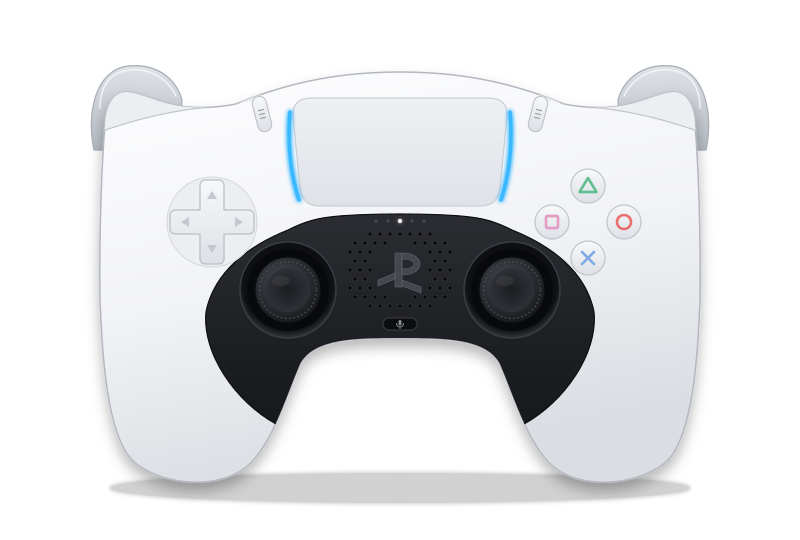

# fictional-engine

## DualSense (PS5) SVG 일러스트

<p align="center"></p>

`dualsense.svg`는 PS5 DualSense 무선 컨트롤러(화이트, CFI-ZCT1W)를 바로 위에서 본 벡터 일러스트예요. 외부 리소스 없이 파일 하나로 끝나고, 배경은 투명해요.

- **단위와 크기**: SVG 1 유닛 = 1 mm. 컨트롤러는 가로 160 mm, 세로 약 106 mm(L1/L2 포함)로 Sony 공식 치수(160 × 66 × 106 mm, 가로 × 두께 × 세로)에 맞췄어요. 좌우 대칭축은 x = 80이고, 대칭인 윤곽은 왼쪽 절반을 그려 뒤집어서 만들어요.
- **그린 부분**: 흰 셸과 검은 센터 트림(그립 안쪽 끝까지), 터치패드와 양옆 라이트 바(1P 파란색), 플레이어 LED 다섯 개(1P는 가운데만 켜짐), 스피커 그릴, PS 버튼, 마이크 음소거 버튼, 투명 캡의 십자키와 액션 버튼(△ ○ × □), 아날로그 스틱, Create·Options 버튼과 아이콘, L1/R1과 그 뒤로 보이는 L2/R2.
- **조명**: 빛은 그림 위쪽에서 들어오는 것으로 통일했어요. 흰색과 검은색 배경 어디에 올려도 윤곽이 읽히게 맞췄어요.
- **호환성**: Chromium, resvg, librsvg로 렌더링해 비교했고(Chromium 대비 평균 차이 0.76/255, 0.71/255), 64 px부터 4096 px까지 크기를 바꿔 확인했어요.
- **HTML에 바로 넣을 때**: 모든 id에 `ds-` 접두사가 붙어 있어서, 같은 페이지의 다른 SVG와 id가 겹치지 않아요.

### 다시 만들기

`dualsense.svg`는 `scripts/build_dualsense.py`가 만들어요. 표준 라이브러리만 쓰는 Python 3 스크립트이고, 출력이 매번 같아서 커밋된 SVG가 스크립트와 맞는지 확인할 수 있어요.

```sh
python3 scripts/build_dualsense.py dualsense.svg          # 다시 생성
python3 scripts/build_dualsense.py dualsense.svg --check  # 스크립트와 다르면 종료 코드 1
```

부품 위치·크기는 스크립트 앞쪽 상수(`OUTLINE_L`, `TP`, `SHELL_EDGE_L`, `DPAD_C`, `FACE_C`, `STICK_L`, `PS_C` 등)에, 주요 색은 `PALETTE`에 모여 있어요. 여러 번 그리는 모양(윤곽, 터치패드, PS 로고, 십자키 등)은 `<defs>`에 한 번만 두고 `<use>`로 재사용해요. SVG 파일을 직접 고치기보다 스크립트를 고친 뒤 다시 생성하는 쪽을 권해요.

### 참고한 자료

- **실루엣과 부품 배치**: [PromptFont](https://shinmera.github.io/promptfont/)(SIL OFL 1.1)의 DualSense 기기 글리프(U+2441)를 160 mm 폭으로 맞춰 측정했어요. 이 글리프의 가로세로비(1.525)가 공식 치수비(1.509)와 거의 같아서 기준으로 삼았어요. 글리프 자체를 옮겨 오지는 않았어요.
- **PS 버튼 모양**: [Simple Icons](https://simpleicons.org/)의 PlayStation 로고 패스(CC0).
- **세부 사양**: Sony 부품 명칭 안내, Linux 커널 `hid-playstation` 드라이버(플레이어 LED 패턴, 라이트 바 기본색), 분해 기사와 리뷰(투명 버튼 재질, 스피커 그릴 위치, Create·Options 아이콘 등).

### 알려진 한계

실제 제품 사진과 직접 겹쳐 보지는 못했어요. 그래서 다음 부분은 확인된 자료가 없어 그럴듯한 형태로 그렸어요: 스피커 그릴의 구멍 배열, 라이트 바가 터치패드 아래 모서리를 감싸는 정도, L2/R2가 위에서 보이는 정도, Create·Options 아이콘의 색.

PlayStation, DualSense, PS 로고는 Sony Interactive Entertainment의 상표예요. 이 일러스트는 비공식 팬 아트예요.
